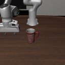
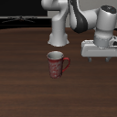

# LatentSTL-LeWM

Research code for **Signal Temporal Logic (STL) over images and learned visual
latents**, using LeWorldModel and the LIBERO robot simulator.

The task is to move a Panda arm across a table while preserving a mug. We test
whether visual predicates can recognize that specification, whether learned
dynamics can predict it, and whether it can guide action selection.

 

## Start here

- [Docker setup](docs/docker.md): reproducible environment for two NVIDIA GPUs.
- [Two-GPU STL suite](docs/stl_suite.md): training, fresh trials, and live reports.
- [Workflow and commands](docs/workflow.md): collect → train → evaluate → plan.
- [Timestamped STL checking](docs/stl_checking.md): nested formulas over images,
  LeWM latents, and action-conditioned forecasts, with calibration and deadline handling.
- [Results and limitations](docs/results.md): what the experiments establish.
- [Data format](docs/data.md) and [LeWM architecture](docs/lewm_adapter_notes.md).
- [Local artifacts](docs/artifacts.md): checkpoints, datasets, and retained runs.

## Setup

For the two-RTX-3090 server, use the [Docker setup](docs/docker.md). It builds
the pinned environment, exposes both GPUs, and keeps datasets and results on
the host.

For the full two-GPU experiment, see the [STL suite protocol](docs/stl_suite.md):
two model seeds, four predicate representations, 1,728 paired fresh trajectories,
96/192-action trials, forecast audits, and live reports with videos and traces.

The Docker environment is validated on Linux with **2 × RTX 3090 (24 GB)**,
Python 3.11, and PyTorch 2.7.1/CUDA 11.8. Training uses FP16, 128 × 128
single-camera images, and independent GPU jobs; there is no DDP. The host needs
Docker Engine, Docker Compose v2 or newer, the NVIDIA driver, and NVIDIA
Container Toolkit configured for Docker.

```bash
git clone https://github.com/kaifanyu/LatentSTL-LeWM.git
cd LatentSTL-LeWM
bash scripts/docker.sh build
bash scripts/docker.sh up
bash scripts/docker.sh doctor
bash scripts/docker.sh test
bash scripts/docker.sh replay 0
bash scripts/docker.sh replay 1
bash scripts/docker.sh shell
```

Inside the container the code is at `/workspace`, and the Python environment is
already configured. `datasets`, `runs`, and `.cache` persist on the host.
The image includes pinned LeWM and LIBERO revisions. No host CUDA compiler or
host Python environment is required for this Docker workflow.

For a native installation, the original Python 3.11 / three-RTX-2080-Ti workflow
is retained in [the workflow guide](docs/workflow.md). It uses
[uv](https://docs.astral.sh/uv/getting-started/installation/):

```bash
bash scripts/setup.sh
source scripts/env.sh
python scripts/doctor.py --expected-gpus 2
RUN_SIMULATOR_TESTS=1 LEWM_RENDER_GPU=0 python -m pytest -q
```

## Main workflow

```bash
# Run from a host terminal after Docker setup. Use a new run name.
bash scripts/docker.sh exec python scripts/run_stl_suite.py --prepare \
  --output /workspace/runs/stl_suite_v1

docker exec -d latentstl-lewm bash -c \
  'exec python /workspace/runs/stl_suite_v1/source_snapshot/scripts/run_stl_suite.py --output /workspace/runs/stl_suite_v1 > /workspace/runs/stl_suite_v1/supervisor.log 2>&1'
```

The two-GPU supervisor runs a finite queue in the background: collect 512/64/64
source episodes, train two seeds, freeze validation-calibrated thresholds, then
evaluate four representations on 1,728 shared fresh trajectories across eight
conditions and two durations. Inspect `runs/stl_suite_v1/status.json` and open
its `index.html` for progress, videos, and predicate traces. Exact trial methods,
SSH viewing, and graceful stopping are in the [suite guide](docs/stl_suite.md).
Add `--smoke` to the preparation command for a small infrastructure check.

Always choose a **new output directory**. The original three-GPU launchers and
individual one-GPU commands remain in [the workflow guide](docs/workflow.md).

The last completed benchmark used a predictor fine-tuned for eight-step
rollouts. Its reproduction command is in [the workflow](docs/workflow.md).
Checkpoints and datasets are **not included in this Git repository**; generate
them locally or use the preserved local artifacts listed in the artifact guide.

## What is being compared?

| Method | Representation used by the predicate |
| --- | --- |
| `global` | One whole-image LeWM latent vector |
| `spatial` | Corresponding LeWM patch features in the mug/goal regions |
| `pixels` | RGB differences in fixed image regions |
| `red_pixels` | Red-color evidence for the mug, RGB differences for the goal |

For each observed trajectory, STL checks **preserve the mug throughout AND
reach the goal sometime**. A separate forecast audit evaluates predicted
global latents. The visual benchmark uses scripted collection trajectories;
offline ranking is not CEM action generation. The existing world model predicts
global latents only, not spatial patch features.

## Current evidence

On 864 fresh trajectories, using validation-balanced thresholds:

| Method | STL / physical-label agreement | Unsafe frames accepted as safe |
| --- | ---: | ---: |
| Global LeWM | 56.6% | 54.1% |
| Spatial LeWM | 91.0% | 16.8% |
| RGB crops | 93.4% | 7.0% |
| Red-mug pixels | 93.3% | 5.0% |

These are classification results, not closed-loop success rates. Small isolated
mug movements expose failures even in the better methods. Earlier successful
CEM trials used demonstration waypoints and action priors; an advantage from
STL and planning from scratch remains unestablished. See the
[full interpretation](docs/results.md).

## Repository layout

```text
latent_stl_lewm/   Models, simulator, predicates, STL, collection, and planners
scripts/          Setup, launchers, monitoring, audits, and report generation
tests/            Automated behavioral and integration tests
docs/             Workflow, architecture, data schema, and compact results
datasets/         Local data only (ignored)
runs/             Local checkpoints, traces, logs, and videos (ignored)
third_party/      Pinned upstream clones, installed by setup (ignored)
```

Experimental planners are retained for reproducibility; the workflow guide
identifies the main entry points. Generated smoke runs and stale launch reports
have been removed. Small result summaries are versioned under `docs/evidence/`.

Built on [LeWorldModel](https://github.com/linzhongzi/le-worldmodel) and
[LIBERO](https://github.com/Lifelong-Robot-Learning/LIBERO). Upstream dependencies
retain their own licenses; this repository does not vendor their source trees.
