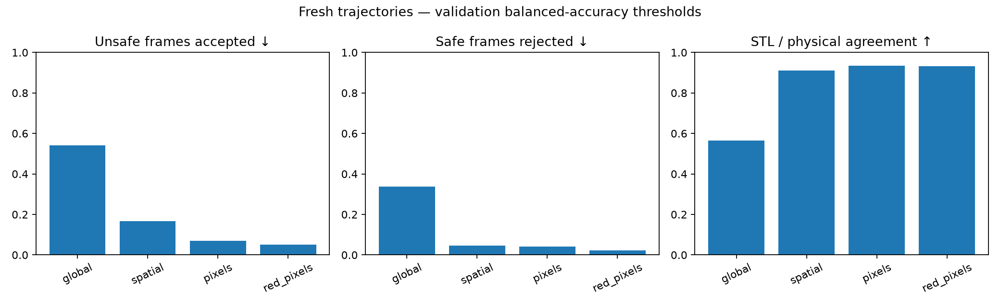

# Results and limits

These are completed experiments as of October 6, 2026. Compact machine-readable
results are in [evidence/](evidence/); raw local artifacts are listed in
[artifacts.md](artifacts.md). Process completion is distinct from scientific success.

## Visual predicate benchmark

The campaign collected 864 fresh trajectories: eight scene conditions, twelve
paired scene seeds per condition, and nine behaviors. Four representations
scored exactly the same images. Calibration used the original validation split;
new outcomes did not change thresholds. The same seeds across conditions are
paired observations, not independent random environments.

Physical success means reaching within 3 cm while keeping mug translation within
2 mm and rotation within 2 degrees at every sampled frame.

| Method, balanced validation threshold | STL agreement | Unsafe frames accepted | Safe frames rejected | Unsafe episodes entirely missed |
| --- | ---: | ---: | ---: | ---: |
| Global LeWM | 56.6% | 54.1% | 33.7% | 37 / 178 |
| Spatial LeWM | 91.0% | 16.8% | 4.7% | 5 / 178 |
| RGB crops | 93.4% | 7.0% | 4.1% | 0 / 178 |
| Red-mug pixels | 93.3% | 5.0% | 2.2% | 3 / 178 |

Spatial/image predicates selected a safe-reaching candidate in all 96 banks
using STL. However, terminal-goal scoring already succeeded in 96/96 spatial
banks and 95/96 pixel banks; a weighted penalty also achieved 96/96. This is
offline selection among already-executed scripted candidates. It does not prove
that CEM can discover those actions or that STL improves control.

Two calibration settings are reported: `balanced` maximizes validation balanced
accuracy; `false_safe_05` takes the largest threshold with at most 5% validation
false-safe frames. The second is not necessarily stricter and is not a guarantee
on new scenes. Red-pixel overall agreement rose to 95.7% under that setting while
unsafe-frame acceptance rose to 14.8% and whole missed disturbances rose to 10.

### Failure probes matter

All four balanced predicates accepted an isolated 4 mm x-shift and 4-degree yaw
in all 16 static probe scenes. Spatial LeWM even accepted a 20 mm x-shift in all
16 cases. Thus high trajectory-level agreement does not establish reliable
preservation at the stated physical tolerance. Static interventions are saved
separately and are not passed off as action-generated trajectories.

The global predictor was additionally audited on recorded actions. In the
eight-step start-jitter audit, observed-image scores accepted 3/16 unsafe windows;
predicted-latent scores accepted 6/16. Both grounding and forecasting need work.
No spatial dynamics predictor was trained in this campaign.

## Earlier closed-loop CEM research

The final frozen comparison comprised 105 simulator trials; development runs are
reported separately. Baseline-scene outcomes were:

| Method | Safe eventual reach | Safe finish |
| --- | ---: | ---: |
| Visual demonstration guide, no CEM | 9 / 10 | 8 / 10 |
| Waypoint CEM, no safety term | 9 / 10 | 7 / 10 |
| Waypoint CEM, original safety references | 8 / 10 | 6 / 10 |
| Waypoint CEM, temporal safety calibration | 9 / 10 | 7 / 10 |
| Final-goal CEM ablation | 0 / 5 | 0 / 5 |

Successful waypoint runs retrieve a successful training demonstration, track its
visual waypoints, and refine its actions through CEM. They are demonstration-
assisted. The guide alone performs similarly, and temporal safety calibration
can miss disturbances. No clear safety or control advantage from STL has been
established. The five final-goal trials are an ablation of the waypoint recipe,
not a universal assessment of all possible CEM implementations.

## What this supports

Object-region image and spatial features provide useful signals for this scene.
Global whole-image preservation is a poor current predicate. Neither positive
learned robustness nor a successful demonstration-guided rollout is a physical
safety certificate or evidence of robust planning from scratch.

The priority is reliable object preservation on counterexamples, followed by
matching spatial dynamics and a controlled planning comparison. Current evidence
is limited to one scene, one red mug, and modest appearance/layout changes.
